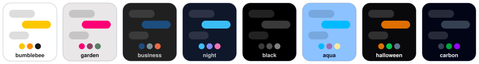

<p align="center">
  
</p>

<h1 align="center">Talkie</h1>
<p align="center"><b>A real-time chat app: add friends, send messages and photos, and pick the theme you like.</b></p>

<p align="center">
  
  
</p>
<p align="center">
  
  
  
  
  
  
  
  
</p>

Talkie is a full-stack messaging app. You sign up, add friends by e-mail, and chat with them one to one. Messages, friend requests, profile changes and online status all arrive instantly over Socket.IO. The frontend is React, the backend is Express with MongoDB.

> Türkçe açıklama aşağıda. The app's interface is in Turkish.

## ✨ Features

- 💬 **Real-time messaging:** one-to-one chats with text and photos, delivered instantly without a page refresh.
- 🟢 **Online status:** see which friends are online right now.
- 🔔 **Unread counters:** a badge on each friend shows how many messages are waiting.
- 🤝 **Friends:** send a request by e-mail, accept or decline, remove or block (and unblock) a friend. If two people send each other a request, they become friends right away.
- 👤 **Profile:** change your photo, name, e-mail and bio; friends see the change immediately.
- 🔐 **Accounts:** passwords are hashed with bcrypt, and the session is a JWT kept in an httpOnly cookie for 7 days.
- 📦 **Your data:** the `/take-data` page lists every message you sent or received, filters by friend and downloads it all as a `.txt` file.
- 🎨 **Themes:** a dark default plus eight more to choose from.

<p align="center">
  
</p>

## 🧱 Tech stack

| Part | Tools |
| --- | --- |
| Frontend | React 19, Vite 6, React Router 7, Zustand, Tailwind CSS 4, daisyUI 5, Axios, lucide-react, react-hot-toast |
| Backend | Node.js, Express 4, Socket.IO 4, Mongoose 8, JSON Web Token, bcryptjs, cookie-parser |
| Services | MongoDB for data, Cloudinary for profile photos and message images |

## 🚀 Run it locally

Requirements: Node.js 18 or newer, a MongoDB database (local or Atlas) and a free Cloudinary account.

**1. Clone the repo**

```bash
git clone https://github.com/shadow-lo/TalkieApp.git
```

**2. Create `backend/.env`**

```ini
PORT=5001
NODE_ENV=development
MONGODB_URI=your-mongodb-connection-string
JWT_SECRET=a-long-random-string
CLOUDINARY_CLOUD_NAME=your-cloud-name
CLOUDINARY_API_KEY=your-api-key
CLOUDINARY_API_SECRET=your-api-secret
```

Keep `PORT=5001` and `NODE_ENV=development`: the frontend calls `http://localhost:5001`, and the login cookie is only sent over plain HTTP in development mode.

**3. Start the backend**

```bash
cd backend
npm install
npm run dev
```

**4. Start the frontend** (in a second terminal)

```bash
cd frontend
npm install
npm run dev
```

Open <http://localhost:5173>, create two accounts, add one from the other by e-mail and start chatting.

## 🔌 API

All routes start with `/api`. Everything except sign-up, login and logout needs the login cookie.

<details>
<summary><b>REST routes</b></summary>

| Method | Route | What it does |
| --- | --- | --- |
| POST | `/auth/signup` | Create an account |
| POST | `/auth/login` | Log in |
| POST | `/auth/logout` | Log out |
| GET | `/auth/check` | Return the logged-in user |
| PUT | `/auth/update-profile` | Update photo, name, e-mail or bio |
| GET | `/messages/users` | Your friends (for the sidebar) |
| GET | `/messages/unread` | Unread message count per friend |
| GET | `/messages/data` | Every message you sent or received |
| GET | `/messages/:id` | Chat history with a friend (marks it as seen) |
| POST | `/messages/send/:id` | Send a text and/or image |
| POST | `/friends/send` | Send a friend request by e-mail |
| POST | `/friends/response/:id` | Accept or decline a request |
| POST | `/friends/remove/:id` | Remove a friend |
| POST | `/friends/block/:id` | Block a friend |
| POST | `/friends/unblock/:id` | Unblock a user |
| GET | `/friends/listRequests` | Pending friend requests |
| GET | `/friends/listBlocked` | Blocked users |

</details>

<details>
<summary><b>Socket.IO events (server → client)</b></summary>

| Event | When |
| --- | --- |
| `getOnlineUsers` | Someone connects or disconnects |
| `newMessage` | A friend sends you a message |
| `newRequest` | Someone sends you a friend request |
| `reqAnswer` | A friend request is accepted |
| `removeFriend` | A friend removes or blocks you |
| `userProfileUpdated` | A user changes their profile |

</details>

## 🗂️ Layout

```text
backend/src/
  index.js              Express app, CORS, routes
  controllers/          auth, friends, messages
  models/               User and Message (Mongoose)
  routes/               /api/auth, /api/friends, /api/messages
  middleware/           protectRoute (JWT cookie check)
  lib/                  MongoDB, Socket.IO, Cloudinary, helpers
frontend/src/
  pages/                home, login, signup, talkie (chat), data, notfound
  modals/               profile and friends dialogs
  components/           navbar, footer, theme dropdown, SVG art
  store/                Zustand stores: auth, chat, theme
  router/               routes and the auth guard
  layouts/              auth and main layouts
```

---

## 🇹🇷 Türkçe

Talkie gerçek zamanlı bir mesajlaşma uygulaması. Kayıt olursun, arkadaşlarını e-posta adresiyle eklersin ve birebir sohbet edersin. Mesajlar, arkadaşlık istekleri, profil değişiklikleri ve çevrimiçi durumu Socket.IO ile anında gelir.

**Özellikler:** yazı ve fotoğraf gönderme, çevrimiçi göstergesi, okunmamış mesaj sayacı, arkadaş ekleme / silme / engelleme, profil düzenleme, verilerini `.txt` olarak indirme ve dokuz tema.

**Kurulum:** MongoDB bağlantısı ve Cloudinary hesabı gerekir. `backend/.env` dosyasını yukarıdaki **Run it locally** bölümündeki gibi oluştur (`PORT=5001` ve `NODE_ENV=development` kalmalı). Sonra iki ayrı terminalde `backend` ve `frontend` klasörlerinde `npm install` ve `npm run dev` çalıştır, tarayıcıda <http://localhost:5173> adresini aç.

**Kullanım:** İki hesap oluştur, birinden diğerini e-postasıyla ekle, isteği kabul et ve yazmaya başla. Temayı palet simgesinden değiştirebilirsin.
